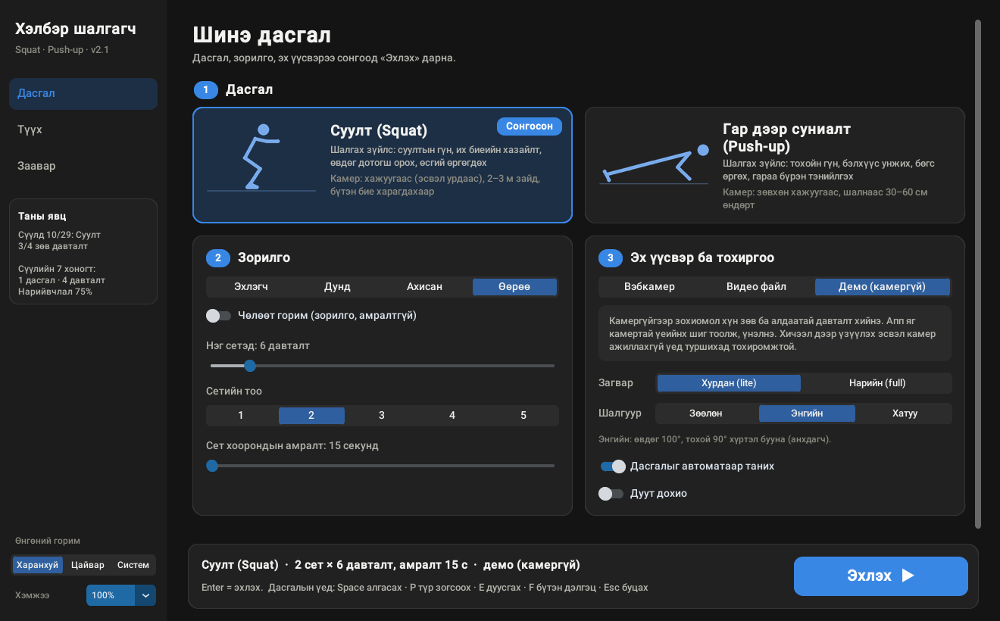
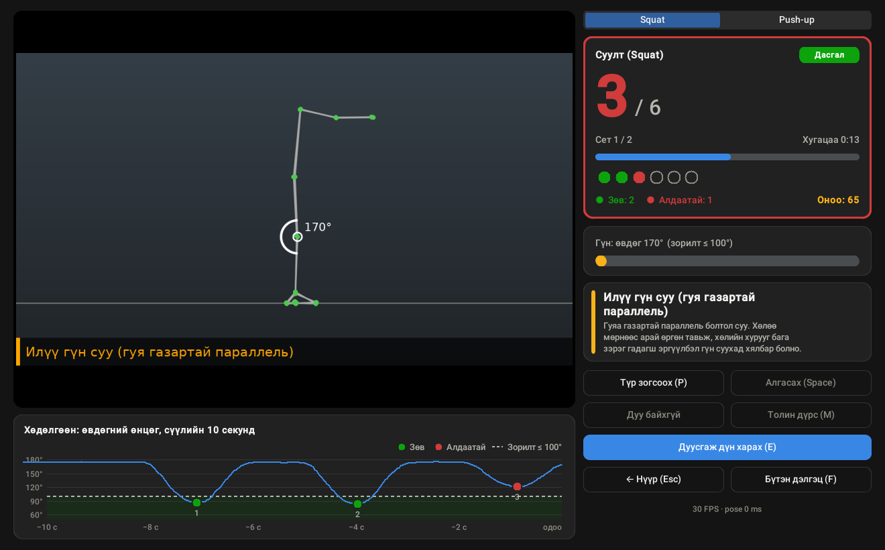

# Дасгалын хэлбэр шалгагч (Body Tracking Form Checker)

Вэбкамераар таныг дасгал хийж байхад бодит хугацаанд харж, **зөв хийж байна уу, үгүй юу** гэдгийг шууд
хэлдэг апп. **Суулт (squat)** ба **гар дээр суниалт (push-up)**-ыг шалгана. **Windows, macOS, Linux** дээр
ажиллана.



- Биеийн 33 цэгийг Google MediaPipe Pose Landmarker загвараар илрүүлнэ.
- Үе мөчний өнцгөөр давталт тоолж, давталт бүрийг «зөв / алдаатай» гэж үнэлээд 0–100 оноо өгнө.
- Алдаа гарвал юуг засахыг монголоор хэлж, дуут дохиогоор давхар мэдэгдэнэ.
- Сет ба амралтын таймер, дүнгийн хуудас, өмнөх дасгалуудын түүх, камергүй демо горимтой.

Хувилбар бүрт юу нэмэгдсэнийг [CHANGELOG.md](CHANGELOG.md)-аас, ашигласан нээлттэй эхийн санааг
[CREDITS.md](CREDITS.md)-аас харна уу.

## Агуулга

1. [Хурдан эхлэх](#1-хурдан-эхлэх): [Windows](#windows-10--11) · [macOS](#macos) · [Linux](#linux)
2. [Гараар суулгах, VS Code](#2-гараар-суулгах-vs-code)
3. [Ашиглах](#3-ашиглах)
4. [Камерыг хэрхэн байрлуулах](#4-камерыг-хэрхэн-байрлуулах)
5. [Юуг шалгадаг вэ](#5-юуг-шалгадаг-вэ)
6. [Асуудал гарвал](#6-асуудал-гарвал)
7. [Төслийн бүтэц](#7-төслийн-бүтэц)

## 1. Хурдан эхлэх

**Хэрэгтэй зүйлс:** 64-bit **Python 3.10–3.13** (3.12-ыг зөвлөнө), вэбкамер (байхгүй бол камергүй демо
горим), анх суулгахад интернэт (сангууд ~150 МБ татагдаж, суулгасны дараа ~520 МБ эзэлнэ).

| Систем | Python | Эхлүүлэх |
|---|---|---|
| Windows 10 / 11 (64-bit) | 3.10–3.13 | `start_windows.bat` давхар товших |
| macOS 11+, Apple Silicon (M1–M4) | 3.10–3.13 | Terminal: `bash start.sh` |
| macOS 11+, Intel | **3.10–3.12** (mediapipe Intel Mac-д 3.12 хүртэл л байдаг) | Terminal: `bash start.sh` |
| Linux x86_64 / ARM64 (Ubuntu 22.04+, Debian 12+, Fedora 38+, Arch) | 3.10–3.13 | Terminal: `bash start.sh` |

Эхлүүлэх скрипт анх удаа аппын хавтсанд `.venv` (тусгаарлагдсан Python орчин) үүсгээд хэрэгтэй сангуудыг
суулгана. Энэ нь хэдэн минут болно. Дараагийн удаа апп шууд нээгдэнэ.

### Windows 10 / 11

1. **Python суулгах.** <https://www.python.org/downloads/> хуудаснаас **Python 3.12**-ын *Windows installer
   (64-bit)*-ийг татаж суулгана. Суулгагчийн эхний цонхонд **«Add python.exe to PATH»**-ийг заавал чагтална.
2. **Аппыг татах.** <https://github.com/enkhbatbyambatsogt81-arch/Kayl> хуудасны ногоон **Code → Download
   ZIP**-ийг дараад ZIP-ээ задлана (эсвэл `git clone https://github.com/enkhbatbyambatsogt81-arch/Kayl.git`).
   Апп нь `body_tracking_app` хавтсанд байгаа. Хавтасны нэр, замд кирилл үсэг байсан ч ажиллана.
3. **Эхлүүлэх.** `body_tracking_app` хавтас доторх **`start_windows.bat`**-ийг давхар товшино.
   - «Windows protected your PC» эсвэл «Open File – Security Warning» гарвал **More info → Run anyway**
     (эсвэл **Run**) дарна. Интернэтээс татсан файлд Windows ингэж асуудаг.
   - Анх удаа хар цонхонд суулгаж буй явц харагдана, дуусмагц аппын цонх нээгдэнэ.
4. **Камерын зөвшөөрөл.** Камер нээгдэхгүй бол *Settings → Privacy & security → Camera* хэсэгт **Camera
   access** ба **Let desktop apps access your camera** асаалттай эсэхийг шалгана.

### macOS

1. **Python суулгах.** <https://www.python.org/downloads/macos/> хуудаснаас **Python 3.12**-ын *macOS 64-bit
   universal2 installer*-ийг суулгана (Tk цонхны сан хамт ордог). Intel Mac бол 3.13-ыг биш 3.12-ыг суулгана.
2. **Аппыг татах.** Дээрх GitHub хуудаснаас **Code → Download ZIP** (эсвэл `git clone ...`).
3. **Эхлүүлэх.** *Terminal* апп нээгээд (Spotlight: `⌘ Space` → Terminal):
   ```bash
   cd ~/Downloads/Kayl-main/body_tracking_app   # аппын хавтас (cd гэж бичээд хавтсаа Terminal руу чирж болно)
   bash start.sh
   ```
4. **Камерын зөвшөөрөл.** Анх камер нээхэд «Terminal would like to access the camera» гэж асуухад **Allow**
   дарна. Санамсаргүй татгалзсан бол *System Settings → Privacy & Security → Camera* хэсэгт **Terminal**
   (VS Code-оос ажиллуулсан бол **Visual Studio Code**)-ыг асаагаад аппыг дахин эхлүүлнэ.

macOS дээр бүтэн дэлгэцийг `F` товчоор асаана (F11 системд эзлэгдсэн байдаг). Аппаас `⌘ Q`-ээр гарч болно.

### Linux

1. **Шаардлагатай багцууд** (Python, цонхны сан Tk, MediaPipe-ийн OpenGL сан):
   ```bash
   # Ubuntu / Debian / Linux Mint
   sudo apt install python3 python3-venv python3-tk libegl1 libgl1 git
   # Fedora
   sudo dnf install python3 python3-tkinter mesa-libEGL mesa-libGL git
   # Arch / Manjaro
   sudo pacman -S python tk mesa git
   ```
2. **Татаж эхлүүлэх:**
   ```bash
   git clone https://github.com/enkhbatbyambatsogt81-arch/Kayl.git
   cd Kayl/body_tracking_app
   bash start.sh
   ```
3. Дэлгэц өндөр нягтралтай (HiDPI, 4K) бол бичиг жижиг харагдаж болно. Зүүн цэсний доод талын **Хэмжээ**-г
   150% эсвэл 200% болгоно (сонголт хадгалагдана).

### Дараагийн удаа

Ижил зүйлээ дахин хийнэ: Windows дээр `start_windows.bat`, macOS / Linux дээр `bash start.sh`. Командын
мөрийн хувилбарыг ажиллуулах бол скриптэд `main.py`-г тохиргоотой нь дамжуулна:

```bash
start_windows.bat main.py --exercise pushup     # Windows, cmd (PowerShell-д: .\start_windows.bat ...)
bash start.sh main.py --exercise pushup         # macOS, Linux
```

## 2. Гараар суулгах, VS Code

Скриптгүйгээр суулгах бол аппын хавтсанд терминал нээгээд:

**Windows** (PowerShell эсвэл cmd):
```bat
python -m venv .venv
.venv\Scripts\python -m pip install -r requirements.txt
.venv\Scripts\python gui.py
```

**macOS / Linux:**
```bash
python3 -m venv .venv
.venv/bin/python -m pip install -r requirements.txt
.venv/bin/python gui.py
```

- Windows-д `py` команд танигдахгүй байж болно. Тэр үед дээрх шиг `python` ашиглана.
- `.venv`-ийг идэвхжүүлбэл (`.venv\Scripts\activate` эсвэл `source .venv/bin/activate`) дараа нь зүгээр
  `python gui.py` гэж бичнэ. PowerShell «running scripts is disabled» гэвэл идэвхжүүлэлгүйгээр дээрх шиг
  `.venv\Scripts\python ...`-ээр шууд ажиллуулна (эсвэл нэг удаа
  `Set-ExecutionPolicy -Scope CurrentUser RemoteSigned`).

**VS Code:**

1. Extensions (`Ctrl+Shift+X`) хэсгээс **Python** (Microsoft) өргөтгөлийг суулгана.
2. *File → Open Folder...* → `body_tracking_app` хавтсыг нээнэ.
3. `.venv` үүсгэнэ: эхлүүлэх скриптийг нэг удаа ажиллуулах эсвэл дээрх командуудыг VS Code-ийн терминалд
   (*Terminal → New Terminal*) бичнэ.
4. `Ctrl+Shift+P` (macOS: `⌘⇧P`) → **Python: Select Interpreter** → `.venv` гэсэн Python-ийг сонгоно.
5. Explorer дээр `vscode_config` хавтсыг баруун товшоод **Rename** → `.vscode` болгоно. Ингэснээр `F5`
   (эсвэл зүүн талын ▷ *Run and Debug*) дарахад доорх жагсаалт гарна:

| Тохиргоо | Юу хийх |
|---|---|
| **Цонхтой интерфейс (GUI) - үндсэн** | Товчлуур, цэстэй цонх нээгдэнэ (доорх 3.1) |
| Squat (вэбкамер) / Push-up (вэбкамер) | Командын мөрийн хувилбар: вэбкамераар шалгана |
| Чөлөөт горим (зорилгогүй, squat) | Сет, амралтгүйгээр тоолно |
| Видео файл дээр шалгах | Өмнө нь бичсэн видеог шалгана |
| Демо (камергүй, командын мөр) | Камергүйгээр зохиомол хүн дасгал хийж буйг үзүүлнэ |
| Хатуу шалгуур + автоматаар таних (2.0, вэбкамер) | `--level strict --auto` |
| Тест ажиллуулах | 82 автомат тест |
| Хурд хэмжих (benchmark) | Таны компьютер дээрх FPS, хоцролтыг хэмжинэ |
| Шүүлтүүрийн харьцуулалт (1€ ба EMA, 2.0) | 1.x ба 2.0-ийн өнцгийн шүүлтүүрийг синтетик өгөгдөл дээр харьцуулна |
| Логикийн нарийвчлал хэмжих (синтетик) | Давталт тоолох, алдаа илрүүлэх нарийвчлал |

Тестийг терминалаас: `.venv\Scripts\python -m unittest discover -s tests` (macOS / Linux:
`.venv/bin/python -m unittest discover -s tests`).

## 3. Ашиглах

### 3.1 Цонхтой интерфейс

Анх нээхэд 3 алхамтай танилцуулга гарна (дараа нь **Заавар → Танилцуулгыг дахин үзэх**).



| Хуудас | Юу байдаг |
|---|---|
| **Дасгал** (нүүр) | 3 алхам: **1** Squat эсвэл Push-up; **2** зорилго (**Эхлэгч / Дунд / Ахисан** эсвэл давталт, сет, амралтаа өөрөө; чөлөөт горим); **3** эх үүсвэр: вэбкамер (**Камер хайх** товч ажиллаж буй камерыг олно, толин дүрс), видео файл эсвэл камергүй демо, мөн загвар (хурдан / нарийн), **шалгуур** (Зөөлөн / Энгийн / Хатуу), дасгалыг автоматаар таних, дуу. Доод самбар юу сонгосныг товч харуулна, **Эхлэх ▶** эсвэл `Enter` |
| **Дасгал хийх үед** | Эхлэхийн өмнө видеоны зүүн дээд буланд **шалгах жагсаалт** (дутуу зүйл шар «›»). Зүүн талд камер ба араг яс, доор нь **хөдөлгөөний график** (сүүлийн 10 секундын өвдөг/тохойн өнцөг; ногоон бүс = зорилтот гүн). Баруун талд том тоолуур (давталт тоологдоход ногоон эсвэл улаанаар гэрэлтэнэ), сет ба хугацаа, давталт бүрийн цэг, сүүлийн давталтын **оноо**, гүний заагч, зөвлөмж, товчлуурууд |
| **Дүн** | Нийт/зөв давталт, нарийвчлал, **дундаж оноо**, **өмнөх ижил дасгалтай харьцуулалт** (▲/▼, шинэ дээд амжилт), **давталт бүрийн гүний график** (хулганаа аваачвал дэлгэрэнгүй), «Юуг сайжруулах вэ» (алдаа улаан, сануулга шар) |
| **Түүх** | `logs/` дахь бүх дасгал: нийт тоо, сүүлийн 14 дасгалын график, хүснэгт. **Бүгд / Squat / Push-up** шүүлтүүр |
| **Заавар** | Камер байрлуулах, товчлуур, асуудал гарвал юу хийх |

Зүүн цэсэнд: **Таны явц** (сүүлийн дасгал, 7 хоногийн дүн, дарвал Түүх нээгдэнэ), **Өнгөний горим**
(харанхуй / цайвар / систем), **Хэмжээ** (80–200%, бүх бичиг, товчлуур, графикийг томруулна/жижигрүүлнэ).

**Товчлуурууд:**

| Товч | Үйлдэл |
|---|---|
| `Enter` | Нүүр хуудаснаас дасгал эхлүүлэх |
| `Space` | 3-2-1 тоолол эсвэл амралтыг алгасах |
| `P` | Түр зогсоох / үргэлжлүүлэх |
| `S` | Дуу асаах / унтраах |
| `M` | Толин дүрс (вэбкамер) |
| `1` / `2` | Squat / push-up руу шилжих |
| `E` | Дасгалыг дуусгаж дүн харах |
| `F` (эсвэл `F11`) | Бүтэн дэлгэц: камераас холоос харахад тохиромжтой |
| `Esc` | Бүтэн дэлгэцээс гарах; дасгалаас гарах (давталт хийсэн бол «Үргэлжлүүлэх / Нүүр хуудас руу / Дүнгээ харах» гэж асууна) |

Камергүй үед эсвэл хичээл дээр үзүүлэхдээ **Демо (камергүй)**-г сонгоно: зохиомол хүн зөв ба алдаатай
давталт хийж, апп яг камертай үеийнх шигээ тоолж, үнэлнэ. Сүүлд сонгосон тохиргоо `settings.json`-д
хадгалагдана (устгавал анхдагч утга руу буцна).

### 3.2 Командын мөрийн хувилбар (`main.py`)

OpenCV-ийн энгийн цонхтой хувилбар. `.venv`-ийн Python-оор (эсвэл эхлүүлэх скриптээр, дээрхийг үз):
```
python main.py                       # squat, вэбкамер 0, 3 сет x 10 давталт, 60 с амралт
python main.py --exercise pushup     # push-up
python main.py --reps 15 --sets 2 --rest 90   # өөр зорилго
python main.py --reps 0              # чөлөөт горим (зорилго, амралтгүй)
python main.py --source 1            # 2 дахь камер
python main.py --source video.mp4    # видео файл
python main.py --source demo         # камергүй демо
python main.py --model full          # илүү нарийвчлалтай, арай удаан загвар
python main.py --level strict        # шалгуур: easy (зөөлөн) / normal (энгийн) / strict (хатуу)
python main.py --auto                # дасгалыг (squat / push-up) автоматаар таних
python main.py --mute                # дуут дохиогүй
python main.py --save result.mp4     # дүнг видео болгон хадгалах
python main.py --lang en             # англи текст
```

**Товчлуурууд:** `1` = squat, `2` = push-up, `Space` = 3-2-1 тоолол эсвэл амралтыг алгасах,
`S` = дуу, `E` = дуусгаж дүн харах, `R` = шинээр эхлэх, `M` = толин дүрс, `Q`/`Esc` = гарах.

Хоёр хувилбар хоёулаа дасгалын дараа давталт бүрийн мэдээллийг `logs/session_*.csv` файлд хадгална (аппын
хавтас дотор). Түүх хуудас эдгээр файлаас уншина.

### 3.3 Дасгал хэрхэн явагддаг вэ

1. **Бэлтгэл:** камерын өмнө зогсоход биеийн аль хэсэг харагдахгүй байгааг хэлнэ («Хөл харагдахгүй байна.
   Камераас холдож зогс» гэх мэт).
2. Бүтэн харагдаж, эхлэх байрлалдаа (squat: шулуун зогсох, push-up: гараа тэнийлгэх) **1 секунд**
   хөдөлгөөнгүй зогсоход хүрээ ногоон болно.
3. **3-2-1** гэж тоолоод эхэлнэ. Үүнээс өмнө хийсэн хөдөлгөөн тоологдохгүй.
4. **Дасгал:** зорилтот гүнд хүрэхэд богино «бип», давталт бүрийн дараа дуут дохио гарна: өсөх ая = зөв,
   буух ая = алдаатай.
5. Сетийн зорилгод хүрэхэд **амралтын таймер** гарна (`Space` = алгасах).
6. Бүх сет дуусахад (эсвэл `E` дарахад) **дүнгийн хуудас** нээгдэнэ.

Видео файл шалгахад тоолол, сетгүйгээр бүх давталтыг шууд тоолно.

## 4. Камерыг хэрхэн байрлуулах

- Камераас **2–3 метр** зайд зогсож, **толгойноос хөл хүртэл** бүтэн харагдах ёстой.
- **Squat:** хажуугаараа зогсвол хамгийн нарийн (өвдөг, их бие, өсгий шалгана).
  Урдаас зогсвол өвдөг дотогш орж байгааг шалгана.
- **Push-up:** заавал **хажуугаас** харагдах ёстой. Камерыг шалнаас 30–60 см өндөрт тавина.
- Гэрэлтүүлэг сайн, ар тал энгийн байвал илүү тогтвортой ажиллана.

## 5. Юуг шалгадаг вэ

| Дасгал | Шалгах зүйл | Босго (`form_checker/config.py`) |
|---|---|---|
| Squat | Гүн: өвдөгний өнцөг ≤ 100° | `depth_angle` |
| Squat | Их бие урагш хэт хазайх > 50° | `max_torso_lean` |
| Squat | Өвдөг дотогш орох (урдаас) | `min_knee_ankle_ratio` |
| Squat | Өсгий газраас салах (хажуугаас) | `max_heel_lift_ratio` |
| Squat | Давталтын хооронд бүрэн босоогүй | `rebound_*` |
| Push-up | Гүн: тохойн өнцөг ≤ 90° | `depth_angle` |
| Push-up | Бэлхүүс унжих / бөгс өргөх: мөр-хонго-шагай < 160° | `min_body_line` |
| Push-up | Дээд байрлалд гараа бүрэн тэнийлгээгүй | `rebound_*` |

**Шалгуурын түвшин.** Нүүр хуудасны «Шалгуур» эсвэл `--level`. Дээрх утгууд «Энгийн» түвшнийх:

| | Зөөлөн | Энгийн | Хатуу |
|---|---|---|---|
| Squat гүн (өвдөг ≤) | 110° | 100° | 90° |
| Squat их биеийн хазайлт (<) | 55° | 50° | 45° |
| Push-up гүн (тохой ≤) | 100° | 90° | 80° |
| Push-up биеийн шугам (>) | 155° | 160° | 165° |
| Хэт хурдан гэх хугацаа (squat / push-up) | 0.7 / 0.5 с | 1.0 / 0.8 с | 1.2 / 1.0 с |
| Хөлийн хуруу / мөрний харьцаа (squat, урдаас) | ≥ 0.75 | ≥ 0.9 | ≥ 1.2 |

**Давталтын оноо.** 100-аас: хэлбэрийн алдаа бүр −20, бүрэн босоогүй/тэнийлгээгүй −15, гүехэн −15…−45
(дутуу градус бүр −1), сануулга бүр (хэт хурдан, хөлийн байрлал) −10. Сануулга давталтыг «алдаатай» болгохгүй.

## 6. Асуудал гарвал

**Бүх систем дээр**

- **Камер нээгдэхгүй:** нүүр хуудасны **Камер хайх** товчоор ажиллаж буй камерын дугаарыг олно. Zoom, Teams,
  хөтчийн видео дуудлага зэрэг камер ашиглаж буй програмыг хаана. Командын мөрөнд `--source 1`.
- **Тоолол эхлэхгүй:** видеон дээрх шалгах жагсаалтын шар «›» мөрийг харна (жишээ нь «Бүтэн бие кадрт
  багтсан» бол камераас холдоно). Бүгд ✓ болоод 1 секунд хөдөлгөөнгүй зогсоход эхэлнэ. Шууд эхлэх бол `Space`.
- **Удаан ажиллаж байна:** «Хурдан (lite)» загварыг сонгоно, командын мөрөнд `--width 640 --height 480`.
- **Цонх, бичиг хэт жижиг / том:** зүүн цэсний **Хэмжээ**.
- **Дасгал өөрөө солигдоод байна:** «Дасгалыг автоматаар таних»-ыг унтраана.
- **Хэт хатуу / зөөлөн санагдаж байна:** «Шалгуур»-аас өөр түвшин сонгоно.
- **`No module named ...`:** эхлүүлэх скриптийг дахин ажиллуулна (дутуу сангуудыг суулгана), эсвэл
  `.venv`-ийн Python-оор `-m pip install -r requirements.txt`.
- **Видеон дээрх монгол үсэг дөрвөлжин харагдана:** кирилл фонт олдоогүй. Аппын хавтсанд `fonts/` хавтас
  үүсгээд кирилл дэмждэг дурын `.ttf` фонт хуулна (Linux: `sudo apt install fonts-dejavu-core`).
- **Дуу гарахгүй:** компьютерийн дууны түвшин, `S` товч (дуу асаалттай эсэх).

**Windows**

- **`python` танигдахгүй эсвэл Microsoft Store нээгдэнэ:** Python-ийг python.org-оос дахин суулгахдаа
  «Add python.exe to PATH»-ийг чагтална. Шаардлагатай бол *Settings → Apps → Advanced app settings → App
  execution aliases* хэсэгт `python.exe`, `python3.exe`-ийн Store alias-ыг унтраана.
- **mediapipe суухгүй:** 32-bit Python суусан байж магадгүй. 64-bit installer-ийг суулгана.
- **Камер:** *Settings → Privacy & security → Camera* → «Let desktop apps access your camera».
- **`No module named tkinter`:** Python-ийг дахин суулгахдаа *tcl/tk and IDLE* сонголтыг идэвхтэй үлдээнэ.

**macOS**

- **Камер харанхуй эсвэл нээгдэхгүй:** *System Settings → Privacy & Security → Camera* хэсэгт Terminal (эсвэл
  VS Code)-ийг асаагаад аппыг дахин эхлүүлнэ.
- **Intel Mac дээр mediapipe суухгүй:** Python 3.12 (эсвэл 3.10, 3.11) хэрэгтэй. `rm -rf .venv` гээд
  python.org-ийн 3.12-ыг суулгасны дараа `bash start.sh`.
- **`No module named _tkinter` (Homebrew Python):** `brew install python-tk@3.12`, эсвэл python.org-ийн Python.
- **`CERTIFICATE_VERIFY_FAILED` (загвар татахад):** `/Applications/Python 3.12/Install Certificates.command`
  файлыг давхар товшино.

**Linux**

- **`libEGL.so.1: cannot open shared object file`:** `sudo apt install libegl1 libgl1`
  (Fedora: `sudo dnf install mesa-libEGL mesa-libGL`).
- **`No module named tkinter`:** `sudo apt install python3-tk` (Fedora: `python3-tkinter`, Arch: `tk`).
- **Камер:** `ls /dev/video*` командаар камер харагдаж байгааг шалгана. Эрх хүрэхгүй бол
  `sudo usermod -aG video $USER` ажиллуулаад системээс гарч дахин нэвтэрнэ.
- **Дуу:** `paplay` (PulseAudio), `pw-play` (PipeWire) эсвэл `aplay` (ALSA)-ын аль нэг хэрэгтэй
  (ихэнх desktop-д бэлэн байдаг; Ubuntu: `sudo apt install pulseaudio-utils`).
- **Цонхны бичиг ширүүн, зарим монгол үсэг дутуу:** Tk нь Xft-гүй хөрвүүлэгдсэн Python (uv, pyenv-ийн зарим
  build) байна. Системийн Python-оор `.venv`-ээ дахин үүсгэнэ:
  `rm -rf .venv && /usr/bin/python3 -m venv .venv && bash start.sh`.

## 7. Төслийн бүтэц

```
body_tracking_app/
├── start_windows.bat        # Windows: давхар товшоод эхлүүлэх (.venv, сангуудыг өөрөө суулгана)
├── start.sh                 # macOS / Linux: bash start.sh
├── gui.py                   # Цонхтой интерфейс (үндсэн)
├── main.py                  # Командын мөрийн хувилбар (OpenCV цонх)
├── benchmark.py             # Хурд хэмжих хэрэгсэл
├── requirements.txt
├── CHANGELOG.md             # Хувилбарын түүх
├── CREDITS.md               # Ашигласан нээлттэй эхийн санаа, лиценз
├── docs/                    # README-ийн зургууд
├── models/                  # MediaPipe загварууд (.task). Байхгүй бол автоматаар татна
├── form_checker/
│   ├── engine.py            # «Хөдөлгүүр»: эх үүсвэр → pose → дасгал → зурах → дуу (GUI ба main.py хоёулаа)
│   ├── camera.py            # Камер нээх: үйлдлийн систем бүрийн backend, камер хайх, зөвлөгөө (2.1)
│   ├── pose.py              # MediaPipe Pose Landmarker-ийг ороосон класс, кадрт багтах шалгалт
│   ├── geometry.py          # Өнцөг тооцоолол, шүүлтүүр (median + 1€ / EMA)
│   ├── recognition.py       # Дасгалыг биеийн байрлалаар автоматаар таних
│   ├── config.py            # Бүх босго утга
│   ├── messages.py          # Монгол/англи зөвлөмжийн текст
│   ├── ui.py                # Видеон дээр араг яс, тоолуур, мессеж зурах
│   ├── session.py           # FPS хэмжилт, дүн, CSV лог
│   ├── workout.py           # Дасгалын явц: эхлэх заавар, 3-2-1, сет, амралт, дүн
│   ├── audio.py             # Дуут дохио (WAV үүсгээд системийн тоглуулагчаар тоглуулна)
│   ├── history.py           # logs/ доторх CSV-ээс түүх унших
│   ├── settings.py          # GUI-ийн тохиргоо (settings.json) хадгалах
│   ├── gui/
│   │   ├── app.py           # Үндсэн цонх, зүүн цэс (Хэмжээ, өнгө), товчлуур
│   │   ├── pages.py         # Дасгал, дасгал хийх, дүн, түүх, заавар хуудсууд
│   │   ├── widgets.py       # Карт, тоолуурын цэг, графикууд (DPI-д тааруулж томорно)
│   │   ├── overlays.py      # Танилцуулга, «дуусгах уу?» асуулт, шалгах жагсаалт
│   │   ├── worker.py        # Камерыг тусдаа урсгалд (thread) ажиллуулах
│   │   ├── ctk_fixes.py     # CustomTkinter-ийн нуусан элемент дахин гарч ирэх алдааны засвар (2.1)
│   │   └── theme.py         # Өнгө, фонт, товчлуурын хэв маяг (харанхуй/цайвар)
│   └── exercises/
│       ├── base.py          # Давталт тоолох төлөвийн машин, алдаа тогтворжуулах
│       ├── squat.py         # Squat-ын дүрэм
│       └── pushup.py        # Push-up-ын дүрэм
├── tools/
│   ├── synthetic.py         # Камергүйгээр тест хийх зохиомол хөдөлгөөн үүсгэгч
│   ├── evaluate_logic.py    # Логикийн нарийвчлалыг тоогоор хэмжих
│   └── evaluate_filters.py  # Өнцгийн шүүлтүүрүүдийг (1€, EMA) харьцуулах
├── sounds/                  # Дуут дохионы WAV файлууд (байхгүй бол автоматаар үүснэ)
└── tests/
    ├── test_logic.py        # Өнцөг, давталт, алдаа илрүүлэх
    ├── test_workout.py      # Дасгалын явц, кадрт багтах, дуу, дэлгэц
    ├── test_app.py          # Хөдөлгүүр (демо), түүх, тохиргоо, цонхтой интерфейс
    ├── test_v2.py           # 2.0: 1€ шүүлтүүр, түвшин, оноо, автоматаар таних, түр зогсолт
    └── test_platform.py     # 2.1: камерын backend, кирилл зам, «Хэмжээ», томруулалт
```
